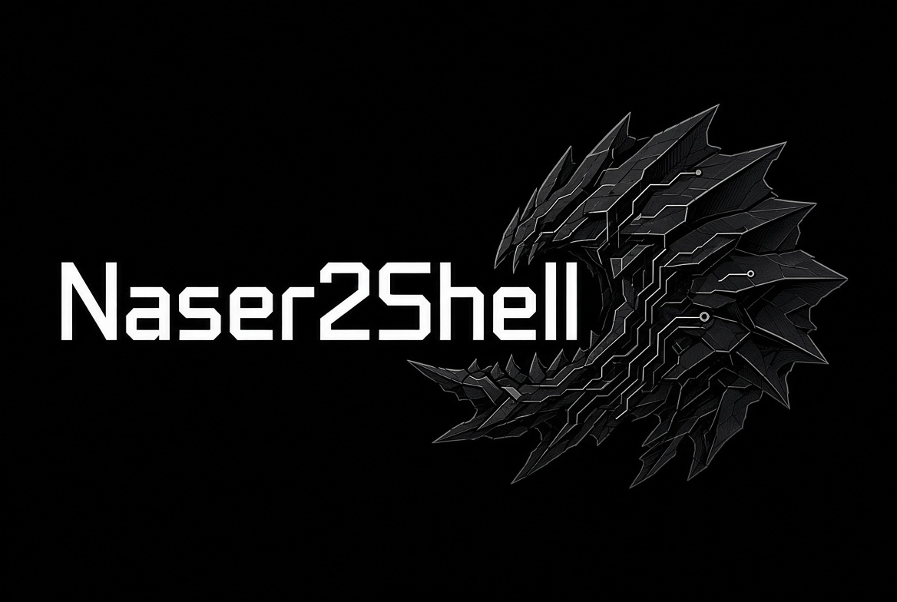

# NASER2SHELL ZEROdays

**攻 Security Research // naser.solutions**

*Every weakness leaves a trace.*

---

## // THE ARCHIVE

A technical security-research archive documenting vulnerabilities and weaknesses identified during analysis of **naser.solutions**.

Each entry aims to include:

- Root cause and affected code
- Attack scenario and prerequisites
- Proof of concept and reproduction steps
- Severity assessment (CVSS) and impact
- Mitigation and verification guidance

## // NASER2SHELL ZEROdays

The name **Naser2Shell ZeroDays** is the project's research label. Findings are individually classified as **confirmed**, **potential**, **informational**, or **false positive**. The label does not claim that every issue is an undisclosed or exploitable zero-day.

## // TEST SCOPE

PoCs are intended for controlled local environments only (localhost, isolated test instances and mocks). Production systems were not tested. Every finding must state its actual evidence and test scope; unverified claims must remain clearly marked.

## // LEGAL

**AUTHORIZED SECURITY RESEARCH ONLY.**

This repository is provided for educational and defensive purposes, **AS IS**, without warranties. Publishing code or PoCs does not grant permission to scan, access, exploit or disrupt naser.solutions or any third-party system. Test only systems you own or have explicit written authorization to assess.

The authors and contributors are not responsible for unauthorized use or resulting damage, to the extent permitted by law. Nothing here is legal advice or a guarantee that findings are current, complete or exploitable.

---

**NO AUTHORIZATION // NO TESTING**

NASER2SHELL ZEROdays · Research archive

